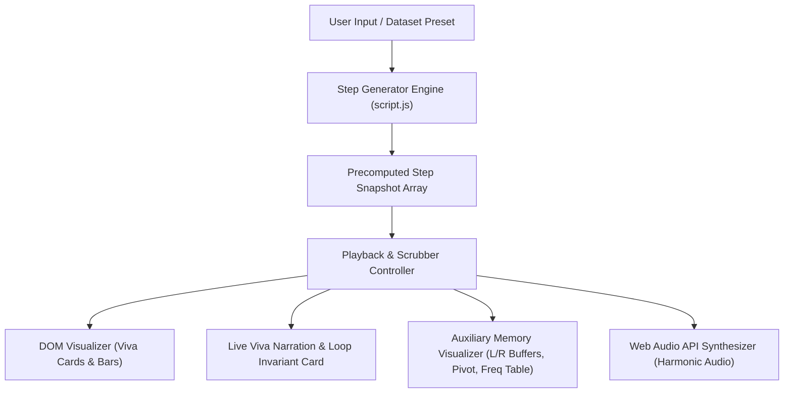

# DAA Sorting Algorithm Visualizer & Viva Defense Lab

A comprehensive, educational sorting algorithm visualizer designed specifically for **Design & Analysis of Algorithms (DAA)** university coursework, classroom lectures, and viva examinations.

Built with **pure HTML5, CSS3, and Vanilla JavaScript** — zero external dependencies, frameworks, or npm packages required. Opens directly in any web browser.

---

## 🎯 The Problem with Traditional Bar Visualizers

Traditional visualizers show 40 to 100 thin bars flashing red and green at high speed. While visually flashy, they are **impossible for a student or viva examiner to understand or explain**:
- You cannot see what values are inside the elements.
- You cannot track which loop variables (`i`, `j`, `k`, `min_idx`, `pivot`) point to which elements.
- You cannot see which condition is evaluated (e.g. `A[j] > A[j+1] → TRUE`).
- You cannot see why an exchange or shift occurred.
- You cannot step backward if an examiner says, *"Wait, go back one step and explain that swap!"*

---

## 🚀 Key Educational Features in This Project

### 1. 🎓 Viva Card View (Educational Mode)
- **Numbered Element Cards:** Crisp cards showing the exact integer values in bold font, with index tags `[0]`, `[1]`, `[2]`, etc.
- **Floating Pointer Badges:** Dynamic pins with arrows pointing directly down at the active cards:
  - `▲ i` (Outer pass pointer)
  - `▲ j` / `▲ j+1` (Inner scanning and comparison pointers)
  - `▲ min_idx` (Minimum element candidate in Selection Sort)
  - `★ Pivot` (Partition pivot in Quick Sort)
  - `▲ Key` (Element being inserted in Insertion Sort)
  - `▲ Left` / `▲ Right` (Subarray boundaries in Merge Sort)

### 2. 📊 Bar Spectrum View (Macroscopic Scale Mode)
- Available at any time via a 1-click toggle for observing asymptotic behavior and macroscopic patterns on larger arrays (up to 50 elements).

### 3. 💡 Live "Why This Step?" Viva Narration Card
- Positioned right above the visualizer:
  - **Action Tag:** e.g., `COMPARING`, `SWAPPED`, `KEY EXTRACTED`, `PIVOT PLACED`, `FIXED IN PLACE`.
  - **Live Logical Condition:** e.g. `A[2] (25) > A[3] (12) → TRUE (Out of order!)`.
  - **Plain-English Explanation:** Explains *why* the algorithm did what it did.
  - **Loop Invariant Spotlight:** Highlights the exact formal loop invariant for that step to explain to faculty.

### 4. 🐍 Clean Python Pseudocode & Implementation
- Displays authentic, clean, idiomatic Python 3 pseudocode for every algorithm.
- Non-synchronized and distraction-free: no jumping lines or distracting code flashing.
- Includes a 1-click **📋 Copy Code** button to copy the Python implementation directly to your clipboard for notebooks, assignments, or viva reports.

### 5. 🧩 Auxiliary Data Structure Visualizer
- **Merge Sort:** Displays separate `Left Buffer L` and `Right Buffer R` during the merge phase, showing elements being chosen one-by-one and written into `A[k]`.
- **Quick Sort:** Shows the chosen pivot and tracks the Lomuto partition boundary (`< pivot` vs `≥ pivot`).
- **Insertion Sort:** Shows the extracted `Key` in a dedicated holding slot while elements shift right to make room.
- **Counting Sort:** Displays the actual frequency table `C[0..k]` with live counter increments and output reconstruction.

### 6. ⏯ Full Bidirectional Step Control
- **▶ Play / ⏸ Pause**
- **Step Forward (→):** Advance exactly 1 atomic step.
- **Step Backward (←):** Rewind exactly 1 atomic step! (Crucial when an examiner asks to re-examine a previous comparison).
- **Scrubber Bar:** Drag to scrub directly to any point in the sorting process.
- **Auto-Pause on Milestone:** Automatically pauses after each outer-loop pass or partition so you can explain the milestone to your examiner.

### 7. 🔊 Web Audio API Synthesizer
- Generates gentle, harmonic sine wave tones with frequencies proportional to element values. Includes an on/off toggle.

### 8. ⚡ Empirical Benchmark Runner
- Runs all 8 algorithms head-to-head on the current array to compare actual execution times (ms), comparisons, swaps, and memory writes.

---

## 📚 8 Implemented Algorithms

| Algorithm | Category | Best Case | Average Case | Worst Case | Auxiliary Space | Stable? | In-Place? | Adaptive? |
| :--- | :--- | :--- | :--- | :--- | :--- | :--- | :--- | :--- |
| **Bubble Sort** | Exchange | $O(n)$ | $O(n^2)$ | $O(n^2)$ | $O(1)$ | Yes | Yes | Yes (early break) |
| **Selection Sort** | Selection | $O(n^2)$ | $O(n^2)$ | $O(n^2)$ | $O(1)$ | No | Yes | No (min writes: $O(n)$) |
| **Insertion Sort** | Insertion | $O(n)$ | $O(n^2)$ | $O(n^2)$ | $O(1)$ | Yes | Yes | Yes ($O(n)$ on sorted) |
| **Merge Sort** | Divide & Conquer | $O(n \log n)$ | $O(n \log n)$ | $O(n \log n)$ | $O(n)$ | Yes | No | No (predictable) |
| **Quick Sort** | Divide & Conquer | $O(n \log n)$ | $O(n \log n)$ | $O(n^2)$ | $O(\log n)$ | No | Yes | No (fastest average) |
| **Heap Sort** | Selection / Heap | $O(n \log n)$ | $O(n \log n)$ | $O(n \log n)$ | $O(1)$ | No | Yes | No (guaranteed $O(n \log n)$) |
| **Shell Sort** | Diminishing Gap | $O(n \log n)$ | $\approx O(n^{1.5})$ | $O(n^2)$ | $O(1)$ | No | Yes | Yes |
| **Counting Sort** | Non-comparison | $O(n + k)$ | $O(n + k)$ | $O(n + k)$ | $O(n + k)$ | Yes | No | No (breaks $\Omega(n \log n)$) |

---

## 📁 Project Structure

This project follows a **clean, modular, zero-dependency** architecture. There are no build tools, bundlers, or package managers required — making it instantly runnable, inspectable, and auditable in any modern web browser for demonstrations.

```
Sorting-Algorithm-Visualization/
│
├── index.html       # Single-page UI layout & semantic structure
├── style.css        # Comprehensive design system, themes & animations
├── script.js        # Algorithm generators, state engine & audio synth
└── README.md        # Documentation, complexity matrix & viva defense guide
```

### File Breakdown & Responsibilities

| File | Description & Core Responsibilities |
| :--- | :--- |
| [`index.html`](index.html) | • **App Shell & Topbar:** Header brand mark, live audio synth toggle, and theme switch (Dark / Light).<br>• **Visualizer Arena:** Dual-mode viewport supporting both the **Viva Card View** (with element indices and pointer badges) and **Bar Spectrum View**.<br>• **Control Sidebar:** Algorithm selector, preset datasets, array size slider, playback speed control, and custom array input parser.<br>• **Viva Defense Panel:** Live narration ("Why This Step?"), evaluated logical expressions, and formal loop invariant spotlight.<br>• **Auxiliary Memory Area:** Dynamic holding buffers for Merge Sort ($L$ and $R$ buffers), Quick Sort pivot, Insertion Sort key slot, and Counting Sort frequency tables.<br>• **Viva Defense Toolkit & Benchmark:** Interactive university viva QA accordion and the head-to-head empirical algorithm benchmark table. |
| [`style.css`](style.css) | • **Design System & Tokens:** Unified CSS custom properties for dark/light themes, typography, elevation, and borders.<br>• **Typography Stack:** High-legibility Google Fonts (`Plus Jakarta Sans`, `Inter`, `Fira Code`).<br>• **Card & Bar Component Styles:** Glassmorphic translucent cards, neon glow state highlights (compare, swap, sorted, pivot), and smooth transition effects.<br>• **Floating Pointers:** Dynamic arrow badges (`▲ i`, `▲ j`, `▲ min_idx`, `★ Pivot`, `▲ Key`, `▲ Left/Right`).<br>• **Responsive Layout:** Adaptive Flexbox and CSS Grid architecture providing seamless viewing across desktop, tablet, and mobile screens. |
| [`script.js`](script.js) | • **Algorithm Step Generators:** Pure atomic generator functions yielding step objects for all 8 algorithms with exact comparison/swap metadata.<br>• **State & Scrubber Engine:** Bidirectional history timeline supporting atomic forward step, backward step, play/pause, milestone auto-pausing, and scrub bar dragging.<br>• **Web Audio API Synthesizer:** Frequency-mapped harmonic sine-wave generator synchronized with active comparisons and swaps.<br>• **Empirical Benchmark Runner:** Asynchronous benchmark suite measuring wall-clock time ($\text{ms}$), comparison counts, swap counts, and array writes.<br>• **DOM Rendering & UI Event Controller:** Real-time pointer placement, card reordering, metrics calculation, and keyboard shortcut event listeners. |
| [`README.md`](README.md) | • **Viva Defense Manual:** Theoretical complexity matrix, loop invariants, keyboard shortcuts, and step-by-step viva presentation guide. |

### 🔄 Architectural Data Flow



---

## ⌨ Keyboard Shortcuts

| Shortcut | Action |
| :--- | :--- |
| `Space` | Play / Pause |
| `→` (Right Arrow) | Next Step |
| `←` (Left Arrow) | Previous Step |
| `R` | Reset to Step 0 |

---

## 🎓 Suggested Walkthrough Script


1. **Start in Viva Card View with the Classic 7-Element Preset:**
   - Explain: *"In this visualizer, each element is a discrete card with its value and index. Floating pointers show exactly which loop variables are inspecting which elements."*
2. **Demonstrate Bubble Sort's Loop Invariant & Adaptivity:**
   - Step through Pass 1. Show `A[j]` and `A[j+1]` swapping when out of order.
   - Point out the `Fixed in Place` green badge at the end of the pass. State the loop invariant: *"After pass $i$, the last $i$ elements are sorted and are $\ge$ all elements in the unsorted prefix."*
   - Change preset to **"Nearly Sorted"** to demonstrate the early break flag achieving $O(n)$ best case.
3. **Showcase Selection Sort's Write Advantage:**
   - Show `min_idx` scanning the unsorted suffix. Explain that Selection Sort performs at most $n - 1$ swaps, which minimizes memory writes when writing to EEPROM/Flash is expensive.
4. **Demonstrate Merge Sort's Auxiliary Buffers:**
   - Switch to Merge Sort. Show the `Left Buffer L` and `Right Buffer R` populated in the auxiliary area, and watch the two-finger merge take the smaller element into $A[k]$.
5. **Demonstrate Quick Sort Partitioning:**
   - Show the purple Pivot badge. Point out how pointer `i` maintains the boundary of elements $< \text{pivot}$ while `j` scans. Show how the pivot is swapped into its permanent position.
6. **Open the Viva Exam Defense Toolkit:**
   - Review the built-in questions on Master Theorem, Stability proofs, In-Place memory definitions, and the Decision Tree comparison lower bound ($\Omega(n \log n)$).
7. **Run the Empirical Benchmark:**
   - Click **Run Benchmark** to compare actual CPU execution times and operation counts side-by-side on the exact same array.
